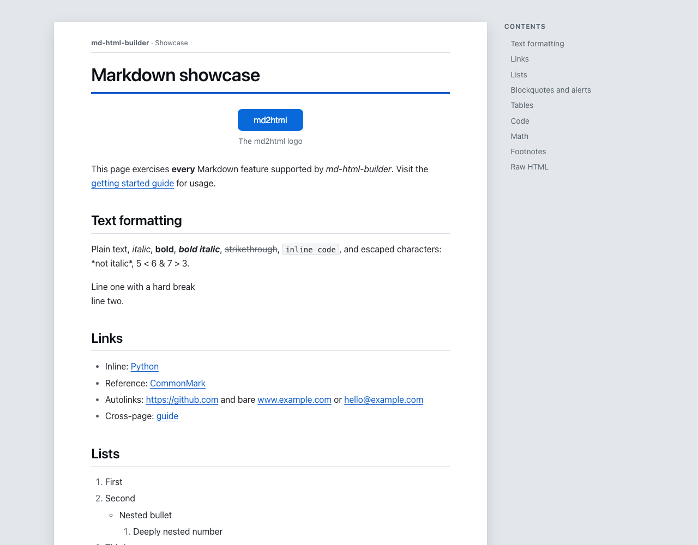
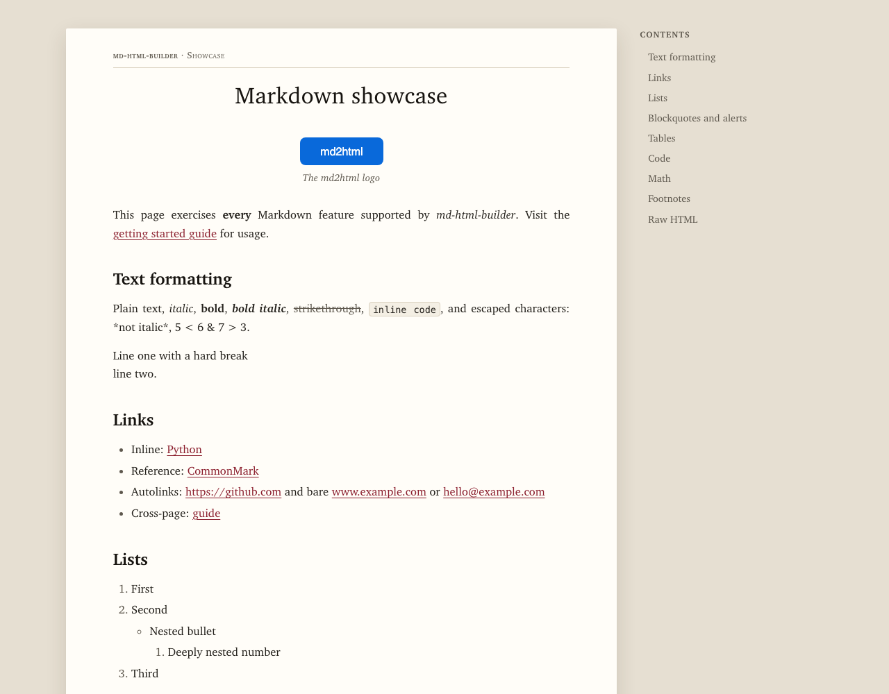
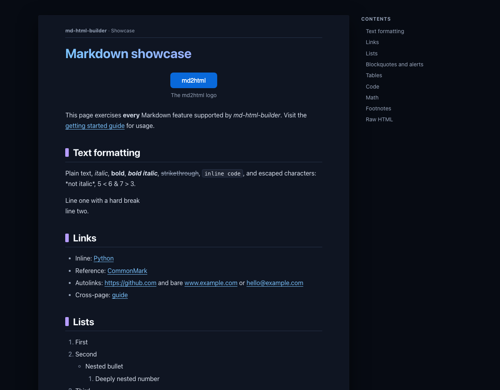
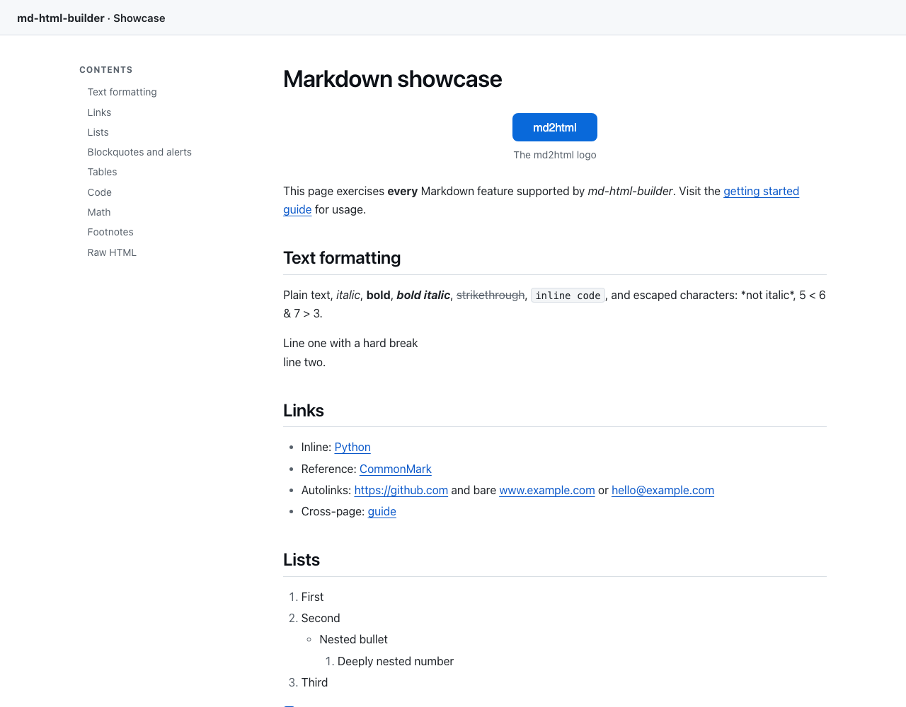
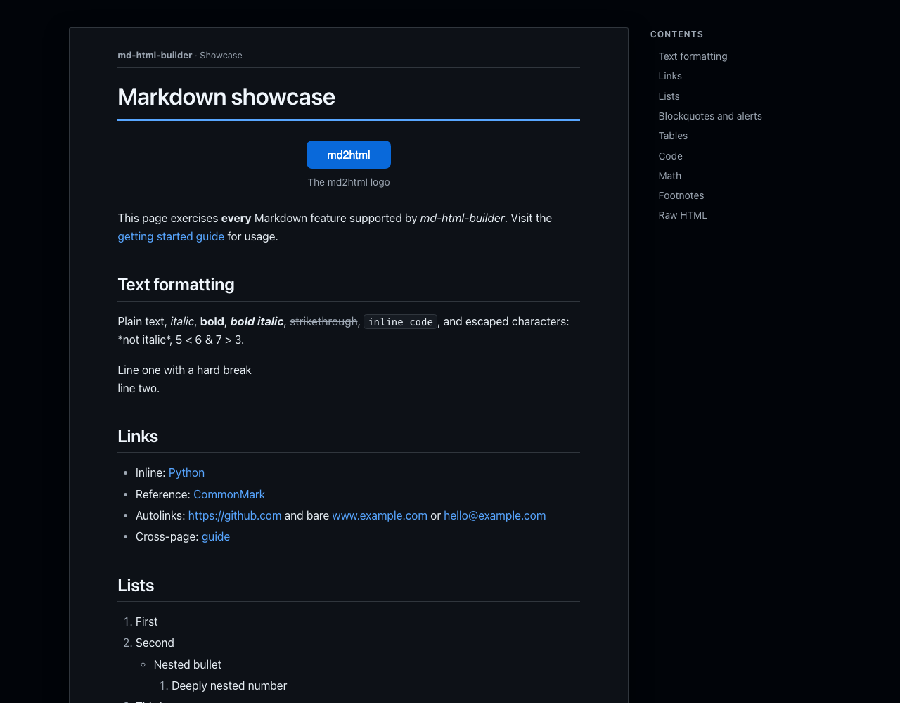
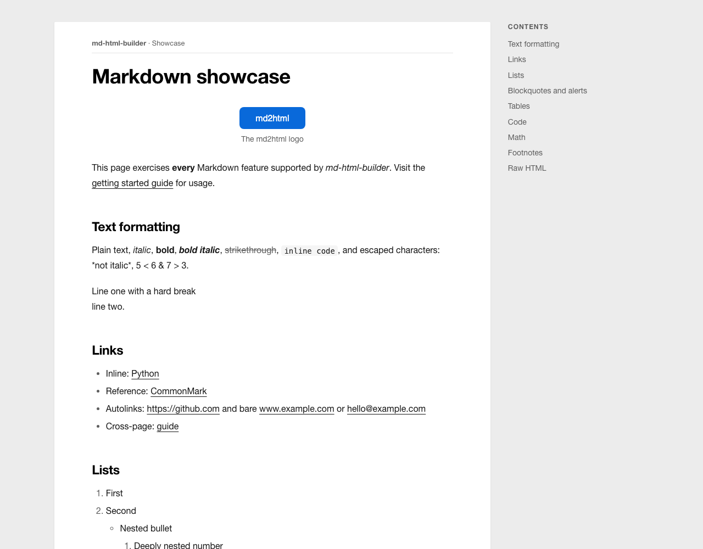

# md-html-builder

Convert Markdown (`.md`) files into styled, customisable HTML pages that look like real
printed documents, or straight into PDF.

- **Looks like a page.** By default each document is shown as a sheet of paper (A4, Letter,
  …) with margins, so the browser's *Print → Save as PDF* gives the same result.
- **HTML, PDF or both.** `md2html notes.md -o notes.pdf` writes a PDF directly.
- **Header, footer and page numbers.** Each one is optional and uses a template. They appear
  on screen and in the margins of every printed or PDF page.
- **Cover page and contents page.** An optional cover (title, subtitle, authors, details,
  date, logo) without header or footer, and a printed contents page with page numbers.
- **Customisable.** Choose from four themes, light/dark/auto mode, fonts, colours, layout,
  table of contents, page size and margins, or add your own CSS or theme.
- **Full Markdown.** Tables, images, links, code blocks with syntax colouring by language,
  footnotes, task lists, alerts, math, front matter and more ([list](#supported-markdown)).

| Default theme | Academic theme | Midnight theme |
|---|---|---|
|  |  |  |

---

## Contents

1. [Installation](#installation)
2. [Quick start](#quick-start)
3. [HTML or PDF](#html-or-pdf)
4. [Header, footer and page numbers](#header-footer-and-page-numbers)
5. [Cover page and contents page](#cover-page-and-contents-page)
6. [Customising the output](#customising-the-output)
7. [Configuration file](#configuration-file)
8. [Supported Markdown](#supported-markdown)
9. [Examples: Markdown in, HTML out](#examples-markdown-in-html-out)
10. [Python API](#python-api)
11. [Running the tests and linting](#running-the-tests-and-linting)
12. [Project layout](#project-layout)
13. [Troubleshooting](#troubleshooting)

---

## Installation

Requires Python 3.11+.

```bash
python -m venv .venv
.venv/bin/pip install -e .              # HTML only
.venv/bin/pip install -e '.[pdf]'       # + WeasyPrint for PDF export
.venv/bin/pip install -e '.[pdf,dev]'   # + pytest and ruff for development
```

(With [uv](https://docs.astral.sh/uv/): `uv pip install --python .venv/bin/python -e '.[pdf,dev]'`.)

This installs the `md2html` command. `python -m md_html_builder` works too.

**PDF export** needs one of two renderers:

| Renderer | Install | Notes |
|---|---|---|
| WeasyPrint (preferred) | `pip install -e '.[pdf]'` plus the Pango libraries: `brew install pango` (macOS) or `apt install libpango-1.0-0 libpangoft2-1.0-0` (Debian/Ubuntu) | Pure Python; keeps the header/footer formatting. On macOS with Homebrew the library path is found automatically. |
| Headless Chrome / Chromium / Edge | Install the browser | Found automatically on `PATH` or in the standard install locations, or set it with `--chrome-path`. |

`--pdf-backend auto` (the default) uses WeasyPrint if it works, otherwise Chrome. HTML
output needs neither.

## Quick start

```bash
md2html README.md                         # -> README.html next to the source
md2html README.md -o README.pdf           # -> a PDF instead
md2html docs/ -o site/                    # a whole folder (the tree is mirrored)
md2html docs/ -o site/ --format both      # HTML pages + a PDF of each
md2html notes.md --theme academic --toc left --header-template "{title}" --page-numbers
md2html docs/ -c examples/md2html.yaml    # use a configuration file
```

Open the `.html` file in any browser. Information commands:

```bash
md2html --list-themes        # built-in themes
md2html --list-code-styles   # Pygments colour schemes for code blocks
md2html --print-config       # the effective configuration (handy as a starting file)
md2html --help               # every option
```

Exit status is `0` on success, `1` on conversion or configuration errors (with a clear
message), and `2` on command-line usage errors.

## HTML or PDF

| You want | Command |
|---|---|
| HTML (default) | `md2html doc.md` or `--format html` |
| PDF only | `md2html doc.md -o doc.pdf` or `md2html docs/ -o out/ --format pdf` |
| Both | `md2html docs/ -o site/ --format both` |

- An output path ending in `.pdf` means PDF, so you don't need `--format pdf`.
- The PDF is printed from the same HTML a browser shows, using the print stylesheet. It has
  the same page size, margins, header, footer and page numbers as the browser's
  *Save as PDF*.
- With `--format pdf`, no HTML is left behind. Each page is rendered to a temporary file,
  printed and deleted. Images are read from their original location, and links between your
  Markdown files point to the other PDFs.
- An existing PDF is only replaced once the new one is complete, so a failed or
  interrupted export never leaves you without a PDF.
- PDF options: `--pdf-backend auto|weasyprint|chrome`, `--chrome-path PATH`,
  `--pdf-timeout SECONDS`, or the `pdf:` section of the config file. The timeout applies
  to Chrome, and to WeasyPrint when it runs in a separate process (as it does on macOS
  with Homebrew). WeasyPrint running inside md2html itself cannot be interrupted.
- **Wide tables.** Print can't scroll, so tables with 7 or more columns are printed with
  smaller text, and cells wrap if they still don't fit. Nothing is cut off at the page
  edge. When a table has more columns than fit comfortably, md2html warns and suggests
  `--orientation landscape`.
- **Math.** With `markdown.math_renderer: mathjax`, formulas are typeset by JavaScript.
  Only Chrome runs JavaScript, so `auto` picks Chrome for those builds. If WeasyPrint is
  used anyway, a warning says the math will appear as TeX source.

You can still print any HTML page from the browser yourself: it shows the document as a
sheet, and printing turns it into real pages.

## Header, footer and page numbers

All three are off by default and can be turned on separately:

```bash
md2html doc.md --header-template "<strong>{site_title}</strong> &middot; {title}" \
               --footer-template "Built {date}" --page-numbers
md2html doc.md --header --footer   # use the configured (or default) templates
md2html doc.md --no-footer         # override a config file that enables it
```

`--header` and `--footer` are on/off switches; a `--header-template` or
`--footer-template` turns its bar on.

On screen, the header and footer sit at the top and bottom of the sheet. When printed or
exported to PDF, they repeat in the top and bottom margin of **every** page, and the page
number reads *Page N of M*.

**Template variables:** `{title}`, `{site_title}`, `{date}`, `{build_date}`, `{year}`,
`{page}`, `{total_pages}`, `{filename}`, `{author}`, `{description}`, plus any key in the
page's YAML front matter. Templates may contain HTML. Variable values are HTML-escaped, and
an unknown variable is an error that lists the available ones.

```yaml
page_numbers:
  enabled: true
  format: 'Page {page} of {total_pages}'   # or '{page}', '- {page} -', ...
  position: right                          # left | center | right
  print: true                              # number printed / PDF pages
```

## Cover page and contents page

Both are off by default and can be turned on separately. They come before the document,
and each one ends with a page break when printed or exported to PDF.

```bash
md2html paper.md -o paper.pdf --cover --contents-page
md2html paper.md -o paper.pdf --cover-subtitle "Draft" --cover-author "Ada Lovelace" \
        --cover-author "Alan Turing" --cover-detail "INTA 6450" --cover-logo logo.png
md2html paper.md -o paper.pdf --contents-depth 3   # list H2 and H3 headings
```

Any `--cover-*` option turns the cover on, and `--contents-depth` turns the contents page on.

**Cover page.** The title is at the top, and the authors, details and date are at the
bottom of the page. The printed cover has **no running header, footer or page number**, but
it still counts as page 1, so the next page is page 2. Every field is optional:

| Field | Default |
|---|---|
| `title` | the page title (front matter `title`, else the first H1) |
| `subtitle` | none |
| `authors` | front matter `author` (a name or a list), else the root `author` setting |
| `details` | none. Use it for extra lines such as a course, organisation or version. |
| `date` | the `{date}` value (front matter `date`, else the build date). `''` hides it. |
| `logo` | none. A relative path in a config file is relative to that file, in front matter it is relative to the Markdown file, and on the command line it is relative to the working directory. A URL is used as-is. The logo is copied, embedded or rewritten like any other image (`build.assets`). |

Values are plain text (HTML is escaped). The most convenient place for them is usually the
page's front matter. A `cover:` mapping turns the cover on and overrides the config, and
`cover: false` turns it off for that page:

```markdown
---
title: Preparing the NowSecure Data
author: [Ada Lovelace, Alan Turing]
cover:
  subtitle: How we built the analysis database
  details: [INTA 6450, Georgia Tech, Fall 2026]
  date: November 2026
contents_page: true
---
```

**Contents page.** It is part of the printed document itself, unlike `layout.toc`, which is
a sidebar or box for reading on screen. You can use both. It lists the headings down to
`contents_page.depth` (default 2). As in the sidebar, a single leading H1 is treated as the
title and left out. With **WeasyPrint**, each entry gets a dotted leader and its page
number. **Chrome** doesn't support CSS `target-counter()`, so it prints the entries as links
without page numbers. Front matter `contents_page: true/false` turns it on or off per page.

```yaml
cover:
  enabled: true
  subtitle: How we built the analysis database
  authors: [Ada Lovelace]
  details: [INTA 6450]
  logo: images/logo.png
contents_page:
  enabled: true
  title: Contents
  depth: 2
  page_numbers: true
```

## Customising the output

Everything can be set three ways: with a command-line flag, in a config file, or with
`--set any.dotted.key=value`. Later sources win: **defaults → `--config` file → flags →
`--set`**.

### Themes and colour mode

| Theme | Look |
|---|---|
| `default` | Clean modern sans-serif, blue accent, light and dark |
| `academic` | Serif, journal style on warm paper, justified text, booktabs tables |
| `midnight` | Dark in every mode, luminous blue/violet accents |
| `minimal` | Monochrome and airy; colour only in code |

```bash
md2html doc.md --theme academic
md2html doc.md --mode dark            # light | dark | auto (follows the OS; prints light)
md2html doc.md --theme ./my-theme/    # your own theme folder or a single .css file
```

A theme is a folder with `theme.css` and, optionally, `theme.yaml` (name, description,
default code styles) and `template.html` (a custom page skeleton). It can also be a single
`.css` file. Themes are built on a shared base stylesheet driven by CSS custom properties,
so a theme usually only sets variables. The full interface (variables, classes, page
structure) is documented at the top of `src/md_html_builder/themes.py`. See
`examples/themes/` for every built-in theme rendered.

### Fonts, colours and CSS

```bash
md2html doc.md --font-body "Georgia, serif" --font-code "JetBrains Mono, monospace" \
               --font-size 17px --line-height 1.7
md2html doc.md --font-url "https://fonts.googleapis.com/css2?family=Inter:wght@400;700" \
               --font-body "Inter, sans-serif"
md2html doc.md --color accent=#e8590c --color link=#e8590c --dark-color accent=#ffa94d
md2html doc.md --var mdh-radius=2px            # any CSS custom property
md2html doc.md --css extra.css                 # your own CSS, loaded last (repeatable)
md2html doc.md --code-style friendly --code-style-dark dracula   # Pygments styles
```

Colour keys (`--color KEY=VALUE`, `style.colors`): `bg`, `surface`, `text`, `muted`,
`heading`, `link`, `accent`, `border`, `code-bg`, `code-text`, `table-header-bg`,
`table-stripe`, `blockquote-border`, `header-bg`, `header-text`, `footer-bg`,
`footer-text`, `desk` (the backdrop around the sheet), `selection`, `mark`, `focus`, and
the alert colours `note`, `tip`, `important`, `warning`, `caution`.

### Layout and page

```bash
md2html doc.md --view web               # classic web page instead of a paper sheet
md2html doc.md --page-size Letter --orientation landscape --margin "25mm 20mm"
md2html doc.md --toc left --toc-depth 2 # table of contents: none | left | right | top
md2html docs/ -o site/ --no-nav         # no page list / previous-next links
md2html doc.md --max-width 60rem --align left   # web view column
```

Page sizes: `A3`, `A4`, `A5`, `B5`, `Letter`, `Legal`, `Tabloid`. The page size and margins
apply to the on-screen sheet, to printing and to PDF.

### Markdown and build options

```bash
md2html untrusted.md --safe          # escape raw HTML
md2html doc.md --line-numbers        # line numbers in code blocks
md2html docs/ -o site/ --link-css    # one shared CSS file instead of inlining it in each page
md2html docs/ -o site/ --assets embed   # copy (default) | rewrite | embed | keep
md2html docs/ --strict               # missing images / unknown code languages are errors
md2html docs/ --no-recursive         # ignore sub-folders
```

## Configuration file

YAML, JSON or TOML. Relative paths in the file (custom CSS, a theme path, the output
folder, `pdf.chrome_path`) are resolved relative to the file. Annotated example:
[`examples/md2html.yaml`](examples/md2html.yaml). Every option with its default
(`md2html --print-config`):

```yaml
title: null                # site title ({site_title}) and fallback page title
lang: en
author: null
description: null
head_html: ''              # trusted HTML appended to <head>
layout:
  view: paged              # paged | web
  max_width: 48rem
  sidebar_width: 16rem
  toc: right               # none | left | right | top
  toc_depth: 3
  toc_title: Contents
  align: center            # center | left
  navigation: true         # page list + previous/next links for multi-page builds
style:
  theme: default
  mode: auto               # light | dark | auto
  font_body: null
  font_heading: null
  font_code: null
  font_size: null
  line_height: null
  colors: {}               # e.g. {accent: '#e8590c'}
  colors_dark: {}
  variables: {}            # raw CSS custom properties
  code_style: null         # Pygments style (light)
  code_style_dark: null    # Pygments style (dark)
  custom_css: []
  font_url: []
header:
  enabled: false
  template: '{site_title}'
footer:
  enabled: false
  template: '{title} &middot; {date}'
page_numbers:
  enabled: false
  format: Page {page} of {total_pages}
  print: true
  position: right          # left | center | right
cover:
  enabled: false
  title: null              # default: the page title
  subtitle: null
  authors: []              # default: front matter author, then the root author
  details: []              # extra lines (course, organisation, ...)
  date: null               # default: {date}; '' hides it
  logo: null
contents_page:
  enabled: false
  title: Contents
  depth: 2
  page_numbers: true       # dotted leaders + page numbers (WeasyPrint)
page:
  size: A4                 # A3 | A4 | A5 | B5 | Letter | Legal | Tabloid
  orientation: portrait    # portrait | landscape
  margin: 20mm 18mm
  print_link_urls: false   # print the URL after each external link
markdown:
  raw_html: true
  safe_mode: false
  typographer: false       # smart quotes and dashes
  breaks: false            # single newlines become <br>
  autolinks: true          # bare URLs / e-mail addresses become links
  heading_anchors: true
  heading_permalinks: false
  math: true
  math_renderer: none      # none | mathjax
  code_line_numbers: false
  guess_language: false
  figures: true            #  alone in a paragraph -> <figure>
build:
  output: null             # file or directory; default: next to each source
  format: html             # html | pdf | both
  recursive: true
  assets: copy             # copy | rewrite | embed | keep
  rewrite_md_links: true   # [x](other.md) -> other.html (or other.pdf)
  inline_css: true
  date_format: '%Y-%m-%d'
  strict: false
  exclude: [node_modules/*, _build/*]
pdf:
  backend: auto            # auto | weasyprint | chrome
  chrome_path: null
  timeout: 120.0           # seconds per page export
```

Invalid values are rejected with the key name and, for misspelt keys, a "did you mean"
suggestion.

**Front matter.** Each Markdown file may start with YAML front matter. `title`, `author`,
`description`, `lang` and `order` (position in multi-page builds) are used directly. Any key
can be used in header/footer templates.

```markdown
---
title: Getting started
order: 2
---
```

## Supported Markdown

| Feature | Syntax |
|---|---|
| Headings (with anchors + table of contents) | `#` … `######`, setext |
| Emphasis, strikethrough | `*em*`, `**strong**`, `***both***`, `~~del~~` |
| Paragraphs, hard line breaks | blank line, two trailing spaces or `\` |
| Blockquotes (nested) | `>` , `> >` |
| Lists: ordered, unordered, nested, task lists | `1.`, `-`, `- [x]` |
| Definition lists | `Term` / `: definition` |
| Tables with alignment, styled | `\| a \| b \|` with `:---`, `:---:`, `---:` |
| Images (alt, title, figure + caption), local paths fixed for the output location | `` |
| Links: inline, reference, autolinks, bare URLs and e-mails, `.md` cross-links | `[t](url)`, `[t][ref]`, `<https://…>` |
| Inline code and fenced/indented code blocks, **coloured by language** (Pygments, 500+ languages) | `` `x` ``, ```` ```python ```` |
| Horizontal rules | `---` |
| Footnotes | `text[^1]` / `[^1]: note` |
| GitHub alerts | `> [!NOTE]`, `[!TIP]`, `[!IMPORTANT]`, `[!WARNING]`, `[!CAUTION]` |
| Math (styled text, or MathJax with `markdown.math_renderer: mathjax`; MathJax in PDF needs Chrome) | `$x^2$`, `$$…$$` |
| YAML front matter | `---` block at the top |
| Raw HTML (escaped with `--safe`) | `<kbd>Ctrl</kbd>` |

`examples/docs/index.md` uses every feature. Its output is in `examples/output/index.html`
and `examples/output/index.pdf`.

## Examples: Markdown in, HTML out

**Input** (`report.md`):

````markdown
## Results

| Name | Score |
|:-----|------:|
| Ada  |    98 |

```python
print("hi")
```


````

**Output** (the `<article>` part of the page; the rest is the page shell, the inlined
stylesheet, and the optional header, table of contents, footer and page number):

```html
<h2 id="results">Results</h2>
<div class="mdh-table-wrap" data-columns="2">
<table>
<thead>
<tr>
<th style="text-align:left">Name</th>
<th style="text-align:right">Score</th>
</tr>
</thead>
<tbody>
<tr>
<td style="text-align:left">Ada</td>
<td style="text-align:right">98</td>
</tr>
</tbody>
</table>
</div>
<div class="mdh-code" data-lang="python"><span class="mdh-code-lang">python</span><div class="highlight"><pre><span></span><code><span class="nb">print</span><span class="p">(</span><span class="s2">"hi"</span><span class="p">)</span>
</code></pre></div>
</div>
<figure class="mdh-figure"><figcaption>Our logo</figcaption></figure>
```

**Ready-made examples** in the `examples/` folder:

| Input | Output | Built with |
|---|---|---|
| `examples/docs/` (2 pages) | `examples/output/index.html`, `guide/getting-started.html` + a `.pdf` of each | `md2html examples/docs -c examples/md2html.yaml --format both` |
| `examples/docs/index.md` | `examples/output/standalone-dark.html` | `md2html examples/docs/index.md -o examples/output/standalone-dark.html --mode dark --toc left --view web --assets embed` |
| `examples/docs/index.md` | `examples/themes/<theme>.html`, `academic.pdf` | see [`examples/themes/README.md`](examples/themes/README.md) |

| Web view, left TOC | Default theme, dark mode | Minimal theme |
|---|---|---|
|  |  |  |

## Python API

```python
from md_html_builder import Config, MarkdownConverter, SiteBuilder, convert

# A complete HTML page as a string
html = convert('# Hello\n\nSome *Markdown*.')

# Configuration from a mapping (same keys as the config file), validated
config = Config.from_dict(
    {
        'style': {'theme': 'academic', 'colors': {'accent': '#e8590c'}},
        'header': {'enabled': True, 'template': '{title}'},
        'page_numbers': {'enabled': True},
    }
)

# Files and folders -> HTML, PDF or both
result = SiteBuilder(config).build('docs/', output='site/')
SiteBuilder(config).build('notes.md', output='notes.pdf')
both = SiteBuilder(config.with_overrides({'build': {'format': 'both'}})).build('docs/', 'site/')
print(both.outputs, both.pdf_outputs)

# Just the body HTML of a snippet
fragment = MarkdownConverter(config).convert_fragment('| a | b |\n|---|---|\n| 1 | 2 |')
```

Every deliberate error derives from `md_html_builder.MdHtmlError`: `ConfigError`,
`ThemeError`, `TemplateError`, `InputError`, `BuildError`, and `PdfError` /
`PdfBackendUnavailableError` (whose message says what to install).

## Running the tests and linting

```bash
.venv/bin/pip install -e '.[pdf,dev]'
.venv/bin/pytest -q                                     # whole suite
.venv/bin/pytest -q tests/test_pdf.py                   # one module
.venv/bin/pytest -q -k "table or code"                  # by keyword
.venv/bin/ruff check src tests && .venv/bin/ruff format --check src tests
```

The tests cover every Markdown feature, the themes and stylesheet, configuration
validation, single-file and multi-file builds, assets and links, the command line, edge
cases (empty files, BOMs, unicode, malformed input, clashing outputs) and PDF export. The
PDF tests use a fake renderer, plus real WeasyPrint and Chrome exports that are skipped when
that renderer is not installed.

## Project layout

```text
src/md_html_builder/
  cli.py          md2html command (CommandLine)
  config.py       typed, validated configuration (Config, ConfigLoader)
  builder.py      orchestration: MarkdownConverter, SourceCollector, SiteBuilder
  parser.py       Markdown -> tokens (markdown-it-py + plugins), front matter, headings
  highlighter.py  code colouring with Pygments
  assets.py       image/file paths and .md cross-links
  renderer.py     page assembly: header, TOC, navigation, footer, templates
  templating.py   safe {variable} templates
  printing.py     @page rules: paper size, margins, running header/footer, page numbers
  frontpages.py   cover page and printed contents page
  themes.py       theme loading and stylesheet assembly (theme interface documented here)
  pdf.py          PDF export: PdfExporter with WeasyPrint and Chrome backends
  themes/         built-in themes + shared base.css
  templates/      page skeletons (web and paged views)
tests/            pytest suite
examples/         sample Markdown, config, generated HTML/PDF and screenshots
```

Each step is a separate class with a small interface. A new theme is a folder with a
CSS file. A new PDF renderer is a `PdfBackend` subclass. When a subclass defines its own
`name`, it registers under that name, joins `auto`, and becomes a valid `pdf.backend`
value. A subclass that only inherits a name (for example, one that tweaks `ChromeBackend`)
doesn't replace the original, and reusing a taken name is an error unless the class passes
`replace=True`. The `md2html` command doesn't load your code, so a custom backend is used
through the Python API, in the process that defines it:

```python
import shutil
import subprocess
from pathlib import Path
from typing import ClassVar

from md_html_builder import Config, SiteBuilder
from md_html_builder.pdf import PdfBackend


class PrinceBackend(PdfBackend):
    name: ClassVar[str] = 'prince'

    def unavailable_reason(self) -> str | None:
        return None if shutil.which('prince') else 'Install Prince from princexml.com'

    def _export(self, html_path: Path, pdf_path: Path) -> int | None:
        subprocess.run(
            ['prince', str(html_path), '-o', str(pdf_path)], check=True, timeout=self.timeout
        )
        return None  # page count unknown; it is read from the PDF


config = Config.from_dict({'pdf': {'backend': 'prince'}})
SiteBuilder(config).build('report.md', output='report.pdf')
```

## Troubleshooting

| Problem | Fix |
|---|---|
| `No PDF backend is available` | Install WeasyPrint (`pip install -e '.[pdf]'` + Pango) or Chrome; the message lists what is missing for each. |
| WeasyPrint: *could not load its system libraries* | `brew install pango` / `apt install libpango-1.0-0 libpangoft2-1.0-0`, or use `--pdf-backend chrome`. |
| Chrome not found | `--chrome-path "/path/to/chrome"` (or `pdf.chrome_path`). |
| Very long document times out | `--pdf-timeout 600`. |
| Table squeezed in the PDF | Use `--orientation landscape` or a larger `--page-size` (md2html warns when this applies). |
| Math shows as `\(...\)` in the PDF | MathJax needs JavaScript: install Chrome or use `--pdf-backend chrome`. |
| Input `notes.html` refused: "would overwrite the input file" | The output would replace the source. Rename the input to `.md` or pass `-o`. |
| `warning: Unknown code language` | The block is shown uncoloured; fix the language name or use `--strict` to make it an error. |
| Images missing in the output folder | The default `--assets copy` copies them; `rewrite` points at the originals; `embed` puts them in the HTML. |
| Contents page has no page numbers | Page numbers need CSS `target-counter()`, which WeasyPrint supports and Chrome doesn't. Use `--pdf-backend weasyprint`. |
| Dark page prints dark | Only `--mode dark` prints dark; `auto` always prints light. |
